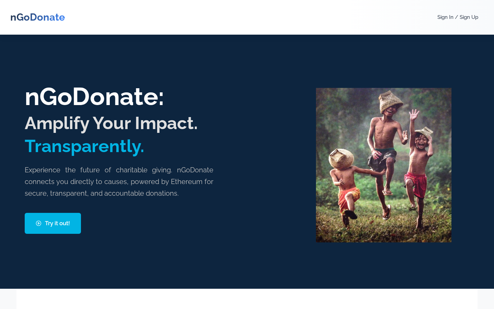

# nGoDonate: Blockchain-Based Transparent Charity Platform

Ethereum charity platform with milestone-based escrow, ERC-721 donation certificates and IPFS metadata, built for NTU SC4053; nGoDonate won Best Developer Tooling at the EasyA x Ripple hackathon (hackathon build: [easya-hackathon](https://github.com/Unknown-Blaze/easya-hackathon)).

[](https://react.dev/)
[](https://fastapi.tiangolo.com/)
[](https://soliditylang.org/)
[](https://sepolia.etherscan.io/)
[](https://sc-4053-bc-project.vercel.app/)

[](https://github.com/Unknown-Blaze/easya-hackathon)



## What it does

NGOs publish a charity project as a set of funding milestones. Each project gets its own `MultiMilestoneEscrow` contract on Ethereum Sepolia: donations are locked in escrow and released to the NGO only when a milestone is completed and verified, with the proof document stored on IPFS. Every donor receives an ERC-721 certificate whose metadata lives on IPFS, and a session-wallet option lets donors give without managing MetaMask.

## Tech

- **Contracts:** Solidity 0.8.20, OpenZeppelin, Hardhat (`backend/contracts/`)
- **Backend:** FastAPI, Web3.py, Firebase Admin, Pinata IPFS (`backend/`)
- **Frontend:** React 19, Vite, Chakra UI, ethers.js, Firebase Auth (`frontend/`)
- **Deploy:** Vercel (frontend), Railway (backend), Docker Compose for local runs

## Run

Both halves read a `.env` file; the variables are listed under [Setup and Installation](#setup-and-installation) below.

```bash
# backend: API on http://localhost:8000 (Swagger at /docs)
cd backend
pip install -r requirements.txt
npm install && npm run compile      # Hardhat compiles the Solidity contracts
uvicorn main:app --reload

# frontend: http://localhost:5173
cd frontend
npm install
npm run dev
```

Or run both with `docker compose up --build` (needs `backend/.env`, `backend/serviceAccountKey.json` and `frontend/.env`).

**SC4053 Blockchain Technology - Course Project**  
**Nanyang Technological University**

---

## 🌐 Live Application

**Access the deployed application here:**  
### **[https://sc-4053-bc-project.vercel.app/](https://sc-4053-bc-project.vercel.app/)**

**Production Infrastructure:**
- **Frontend**: Deployed on Vercel
- **Backend API**: Deployed on Railway  
- **Blockchain Network**: Ethereum Sepolia Testnet
- **Storage**: IPFS (Pinata) + Firebase

---

## Project Overview

nGoDonate is a decentralized charity platform built on the Ethereum blockchain that addresses transparency and accountability challenges in charitable donations. The platform enables donors to track fund utilization through milestone-based escrow contracts, while NGOs can demonstrate impact through blockchain-verified progress updates. Additionally, donors receive NFT certificates as proof of their contributions, creating an immutable record of charitable giving.

### Key Features

- **Multi-Milestone Escrow System**: Smart contract-based fund management with milestone verification
- **Transparent Donation Tracking**: Real-time visibility of fund allocation and usage
- **NFT Donation Certificates**: ERC-721 tokens as proof of contribution with IPFS metadata storage
- **Session Wallet Authentication**: Seamless blockchain interactions without requiring donors to manage private keys
- **Firebase Integration**: User authentication and project metadata management
- **IPFS Storage**: Decentralized storage for project documentation and NFT metadata

## Technology Stack

### Frontend
- **React 19**: Modern UI component library
- **Vite**: Fast build tool and development server
- **React Router**: Client-side routing
- **ethers.js**: Ethereum blockchain interaction library
- **Firebase**: User authentication and real-time database
- **Vercel**: Deployment platform

### Backend
- **FastAPI**: High-performance Python web framework
- **Web3.py**: Python library for Ethereum interaction
- **Hardhat**: Ethereum development environment for smart contract compilation
- **IPFS (Pinata)**: Decentralized file storage for metadata
- **Firebase Admin SDK**: Server-side Firebase operations
- **Railway**: Backend deployment platform

### Blockchain
- **Ethereum Sepolia Testnet**: Development and testing network
- **Solidity 0.8.20**: Smart contract programming language
- **OpenZeppelin Contracts**: Secure, audited contract libraries
- **Infura**: Ethereum node provider

## Smart Contract Architecture

### 1. MultiMilestoneEscrow Contract

**Purpose**: Manages charitable projects with milestone-based fund release mechanisms.

**Key Components**:
- **Participants**: 
  - `donor`: Initial project funder who deposits funds
  - `recipient`: NGO receiving funds upon milestone verification
  - `verifier`: Authorized party who validates milestone completion (In this scenario, the verifier is the NGO; however, this could be extended to accommodate external verification from donors/other nodes.)

- **Milestone Structure**:
  ```solidity
  struct Milestone {
      string name;
      string description;
      uint256 amount;
      bool isCompleted;
      bool isVerified;
      uint256 completionTime;
      string verificationHash; // IPFS proof
  }
  ```

- **Core Functions**:
  - `createMilestone()`: NGO adds project milestones with funding requirements
  - `completeMilestone()`: NGO marks milestone complete with verification proof
  - `verifyMilestone()`: Verifier approves completion and releases funds
  - `donate()`: Payable function for public donations
  - `refund()`: Donor can withdraw funds if project cancelled

- **State Management**:
  - `Active`: Contract accepting donations and processing milestones
  - `Completed`: All milestones verified and funds released
  - `Cancelled`: Project terminated, refunds available

### 2. NGO_NFT Contract (ERC-721)

**Purpose**: Mints donation certificates as non-fungible tokens.

**Features**:
- Extends OpenZeppelin's `ERC721URIStorage` and `ERC721Enumerable`
- Each NFT represents a donation event with metadata stored on IPFS
- Token URI points to JSON metadata containing:
  - Donor information
  - Donation amount
  - Project details
  - Certificate artwork
  - Timestamp

**Key Functions**:
- `safeMint(address to, string memory uri)`: Creates new NFT with metadata URI
- Inherited enumeration allows querying all tokens by owner

## System Architecture

### Request Flow

1. **User Authentication** → Firebase handles login/signup
2. **Project Creation** → NGO submits project details via frontend
3. **Backend Processing** → FastAPI validates and stores metadata in Firebase
4. **Smart Contract Deployment** → Backend deploys `MultiMilestoneEscrow` contract
5. **IPFS Upload** → Project details uploaded to IPFS, hash stored on-chain
6. **Donation Flow** → Users donate ETH through frontend → Funds locked in escrow
7. **Milestone Verification** → NGO completes milestone → Verifier approves → Funds released
8. **NFT Minting** → Backend mints certificate NFT to donor's wallet

### Data Storage Strategy

| Data Type | Storage Location | Reason |
|-----------|------------------|--------|
| User accounts | Firebase Auth | Centralized identity management |
| Project metadata | Firebase Firestore | Fast queries, real-time updates |
| Smart contract addresses | Firebase Firestore | Mapping projects to blockchain |
| Milestone details | Ethereum blockchain | Immutable, transparent |
| Donation records | Ethereum blockchain | Transparent tracking |
| Project documents | IPFS (Pinata) | Decentralized, censorship-resistant |
| NFT metadata | IPFS (Pinata) | Decentralized token data |

## Project Structure

```
SC4053-Project/
├── backend/
│   ├── contracts/
│   │   ├── MultiMilestoneEscrow.sol    # Main escrow smart contract
│   │   └── NFT.sol                      # ERC-721 NFT contract
│   ├── routers/
│   │   ├── projects.py                  # Project creation & management
│   │   ├── nft.py                       # NFT minting & gallery
│   │   ├── transaction.py               # Blockchain transaction queries
│   │   └── wallet.py                    # Wallet creation & balance
│   ├── services/
│   │   └── eth_client.py                # Web3 connection & helpers
│   ├── main.py                          # FastAPI application entry
│   ├── compile_contracts.py             # Hardhat compilation script
│   ├── Dockerfile                       # Production deployment
│   └── requirements.txt                 # Python dependencies
├── frontend/
│   ├── src/
│   │   ├── pages/
│   │   │   ├── HomePage.jsx             # Landing page
│   │   │   ├── CreateProject.jsx        # NGO project creation
│   │   │   ├── ProjectsPage.jsx         # Browse all projects
│   │   │   ├── ProjectDisplayPage.jsx   # Project details & milestones
│   │   │   ├── ProjectDonationPage.jsx  # Donation interface
│   │   │   ├── NFTGalleryPage.jsx       # User's NFT certificates
│   │   │   ├── UserProfile.jsx          # User dashboard
│   │   │   ├── UnifiedAuthPage.jsx      # Login/signup
│   │   │   └── MintNFT.jsx              # Admin NFT minting
│   │   ├── contexts/
│   │   │   ├── AuthContext.jsx          # Firebase authentication
│   │   │   └── SessionWalletAuthContext.jsx # Session wallet management
│   │   ├── config/
│   │   │   └── api.js                   # Backend API endpoints
│   │   └── firebase/
│   │       └── config.js                # Firebase configuration
│   └── package.json
└── README.md
```

## Setup and Installation

### Prerequisites

- **Node.js** (v20 or higher)
- **Python** (v3.11 or higher)
- **Git**
- **Ethereum Wallet** (MetaMask recommended for testing)
- **Infura Account** (for Ethereum node access)
- **Firebase Project** (for authentication)
- **Pinata Account** (for IPFS storage)

### Backend Setup

#### 1. Clone the Repository
```bash
git clone https://github.com/Unknown-Blaze/SC4053-Project.git
cd SC4053-Project/backend
```

#### 2. Install Python Dependencies
```bash
python -m venv venv
# Windows
venv\Scripts\activate
# macOS/Linux
source venv/bin/activate

pip install -r requirements.txt
```

#### 3. Install Node.js Dependencies (for Hardhat)
```bash
npm install
```

#### 4. Configure Environment Variables

Create a `.env` file in the `backend` directory:

```env
# Ethereum Configuration
ETHEREUM_NODE_URL=https://sepolia.infura.io/v3/YOUR_INFURA_PROJECT_ID
CHAIN_ID=11155111

# Wallet Configuration
NGO_PRIVATE_KEY=your_ngo_wallet_private_key_here
NGO_ADDRESS=your_ngo_wallet_address_here

# Smart Contract Addresses (deploy NFT contract first)
NFT_CONTRACT_ADDRESS=0x...

# IPFS Configuration
PINATA_API_KEY=your_pinata_api_key
PINATA_SECRET_KEY=your_pinata_secret_key

# Firebase Configuration (Base64 encoded service account)
FIREBASE_SERVICE_ACCOUNT_BASE64=your_base64_encoded_firebase_credentials

# Server Configuration
PORT=8000
```

#### 5. Compile Smart Contracts
```bash
npm run compile
```

This runs Hardhat to compile Solidity contracts and generate artifacts in `backend/artifacts/`.

#### 6. Deploy NFT Contract (One-time Setup)

You can deploy the NFT contract using Hardhat or Remix:

**Using Hardhat** (create `scripts/deploy.js`):
```javascript
const hre = require("hardhat");

async function main() {
  const [deployer] = await hre.ethers.getSigners();
  const NGO_NFT = await hre.ethers.getContractFactory("NGO_NFT");
  const nft = await NGO_NFT.deploy(deployer.address);
  await nft.waitForDeployment();
  console.log("NFT deployed to:", await nft.getAddress());
}

main();
```

```bash
npx hardhat run scripts/deploy.js --network sepolia
```

Copy the deployed address to `NFT_CONTRACT_ADDRESS` in `.env`.

#### 7. Run the Backend Server
```bash
uvicorn main:app --reload
```

The API will be available at `http://localhost:8000`.

**API Documentation**: Navigate to `http://localhost:8000/docs` for Swagger UI.

### Frontend Setup

#### 1. Navigate to Frontend Directory
```bash
cd ../frontend
```

#### 2. Install Dependencies
```bash
npm install
```

#### 3. Configure Environment Variables

Create a `.env` file in the `frontend` directory:

```env
# Backend API
VITE_API_URL=http://localhost:8000

# Firebase Configuration
VITE_FIREBASE_API_KEY=your_firebase_api_key
VITE_FIREBASE_AUTH_DOMAIN=your-project.firebaseapp.com
VITE_FIREBASE_PROJECT_ID=your-project-id
VITE_FIREBASE_STORAGE_BUCKET=your-project.appspot.com
VITE_FIREBASE_MESSAGING_SENDER_ID=123456789
VITE_FIREBASE_APP_ID=1:123456789:web:abc123
VITE_FIREBASE_MEASUREMENT_ID=G-XXXXXXXXXX

# Ethereum Configuration
VITE_NFT_CONTRACT_ADDRESS=0x...  # Same as backend
VITE_CHAIN_ID=11155111
VITE_ETHEREUM_RPC_URL=https://sepolia.infura.io/v3/YOUR_INFURA_PROJECT_ID
```

#### 4. Run Development Server
```bash
npm run dev
```

The application will be available at `http://localhost:5173`.

### Firebase Configuration

#### 1. Create Firebase Project
- Go to [Firebase Console](https://console.firebase.google.com/)
- Create a new project
- Enable **Authentication** → Email/Password provider
- Enable **Firestore Database**

#### 2. Generate Service Account Key (Backend)
- Project Settings → Service Accounts → Generate New Private Key
- Save as `serviceAccountKey.json` in `backend/`
- Convert to Base64:
  ```bash
  python convert_firebase_to_base64.py
  ```
- Copy output to `FIREBASE_SERVICE_ACCOUNT_BASE64` in backend `.env`

#### 3. Get Web Config (Frontend)
- Project Settings → Your apps → Web app
- Copy configuration values to frontend `.env`

### Pinata IPFS Setup

1. Create account at [Pinata.cloud](https://www.pinata.cloud/)
2. Generate API keys from Account → API Keys
3. Add keys to backend `.env`

## Usage Guide

### For NGOs (Project Creators)

#### 1. Create Account
- Navigate to signup page
- Register with email/password
- Firebase automatically creates user profile

#### 2. Create Project
- Go to "Create Project" page
- Fill in project details:
  - Project name, description, category
  - Funding goal
  - Milestones (name, description, funding amount)
- Submit form
- Backend:
  - Uploads metadata to IPFS
  - Deploys `MultiMilestoneEscrow` contract
  - Stores contract address in Firebase
  - Sets NGO as recipient and verifier

#### 3. Manage Milestones
- View project on "Projects" page
- When milestone work is complete:
  - Upload proof documents to IPFS
  - Click "Complete Milestone"
  - Provide IPFS hash as verification
- System calls `completeMilestone()` on contract

#### 4. Verify Milestones
- After completion, verifier approves milestone
- Click "Verify Milestone"
- System calls `verifyMilestone()` on contract
- Funds automatically released to NGO wallet

### For Donors

#### 1. Browse Projects
- View all active projects on "Projects" page
- Filter by category, funding status
- Click project to see details and milestones

#### 2. Make Donation
- On project page, click "Donate"
- Enter donation amount (ETH)
- Two options:
  - **Session Wallet**: System creates temporary wallet, no MetaMask needed
  - **MetaMask**: Connect existing wallet
- Confirm transaction
- Donation recorded on blockchain and Firebase

#### 3. View NFT Certificates
- Go to "NFT Gallery" page
- See all donation certificates
- Each NFT shows:
  - Project name
  - Donation amount
  - Date of contribution
  - Transaction hash
- Metadata stored on IPFS, viewable on OpenSea

### For Administrators

#### Admin Debug Panel
Access at `/admin-debug` with admin credentials:

**Features**:
- View all projects and their contract addresses
- Monitor milestone completion status
- Manually mint NFTs for donors
- Check contract balances
- View transaction history

## API Reference

### Complete Endpoint List

#### Projects Endpoints (`/projects`)

| Endpoint | Method | Description |
|----------|--------|-------------|
| `/projects/create-project` | POST | Deploy new MultiMilestoneEscrow contract with milestones |
| `/projects/all` | GET | Fetch all projects from Firebase with IPFS metadata |
| `/projects/project/{address}/details` | GET | Get contract state, milestones, and donation info |
| `/projects/project/{address}/stats` | GET | Get project statistics (total raised, donors, progress) |
| `/projects/project/{address}/top-donors` | GET | Get top donors ranked by contribution amount |
| `/projects/project/{address}/donor-rank/{donor_address}` | GET | Get specific donor's rank and contribution |
| `/projects/project/{address}/mint-certificate` | POST | Mint NFT certificate for project donation |
| `/projects/project/{address}/verify-milestone/{index}` | POST | Verify milestone completion and release funds |

#### NFT Endpoints (`/nft`)

| Endpoint | Method | Description |
|----------|--------|-------------|
| `/nft/mint` | POST | Mint NFT with custom metadata to recipient address |
| `/nft/mint-donation-certificate` | POST | Mint donation certificate NFT with auto-generated metadata |
| `/nft/gallery/{address}` | GET | Get all NFTs owned by wallet with metadata from IPFS |
| `/nft/stats/{address}` | GET | Get NFT collection statistics (total NFTs, unique projects) |
| `/nft/tokens` | GET | Get NFT tokens for specific address (query param: `address`) |
| `/nft/contract-info` | GET | Get NFT contract address and basic information |

#### Transaction Endpoints (`/transaction`)

| Endpoint | Method | Description |
|----------|--------|-------------|
| `/transaction/latest-transactions` | GET | Get recent transactions for address (query param: `address`) |

#### Wallet Endpoints (`/wallet`)

| Endpoint | Method | Description |
|----------|--------|-------------|
| `/wallet/create` | POST | Generate new Ethereum wallet (address + private key) |

#### Health Check (`/`)

| Endpoint | Method | Description |
|----------|--------|-------------|
| `/` | GET | Root health check endpoint - returns API status and available endpoints |

## Testing

### Local Testing

#### 1. Start Local Blockchain (Optional)
For faster testing without Sepolia:
```bash
npx hardhat node
```

Update backend `.env`:
```env
ETHEREUM_NODE_URL=http://127.0.0.1:8545
CHAIN_ID=31337
```

#### 2. Get Test ETH
For Sepolia testnet:
- Visit [Sepolia Faucet](https://sepoliafaucet.com/)
- Enter your wallet address
- Receive free test ETH

#### 3. Test Smart Contract Functions

**Deploy Test Project**:
```bash
curl -X POST http://localhost:8000/projects/create-project \
  -H "Content-Type: application/json" \
  -d @test_project.json
```

**Make Donation**:
```bash
curl -X POST http://localhost:8000/projects/project/0x.../donate \
  -H "Content-Type: application/json" \
  -d '{"donor_address": "0x...", "amount": "0.1"}'
```

**Verify Transaction on Etherscan**:
- Navigate to [Sepolia Etherscan](https://sepolia.etherscan.io/)
- Search for contract address or transaction hash
- Verify events emitted and state changes

## Security Considerations

### Implemented Security Measures

1. **Private Key Management**:
   - NGO private key stored as environment variable
   - Never exposed to frontend
   - Session wallets created per donation (optional)

2. **Smart Contract Security**:
   - OpenZeppelin audited contracts
   - Access control modifiers (`onlyDonor`, `onlyVerifier`)
   - Reentrancy protection via state updates before transfers
   - Event logging for transparency

3. **API Security**:
   - Firebase authentication required for sensitive operations
   - CORS configured for specific origins
   - Input validation on all endpoints

4. **Frontend Security**:
   - Environment variables for sensitive config
   - HTTPS enforced in production
   - Client-side wallet encryption for session wallets

### Known Limitations

1. **Centralized Components**:
   - Firebase for user management (trade-off for UX)
   - Backend server required for contract deployment (could be decentralized)

2. **Testnet Only**:
   - Currently deployed on Sepolia testnet
   - Not production-ready for mainnet

3. **Verifier Trust**:
   - Milestone verification relies on trusted verifier
   - Could be enhanced with multi-sig or DAO governance

## Project Challenges and Solutions

### Challenge 1: Smart Contract Deployment Gas Costs
**Problem**: Each project requires deploying a new contract, incurring gas fees.  
**Solution**: Use factory pattern in future versions to clone minimal proxy contracts, reducing deployment costs by ~10x.

### Challenge 2: IPFS Pinning Reliability
**Problem**: Free IPFS gateways can be slow or unreliable.  
**Solution**: Integrated Pinata for guaranteed pinning with dedicated gateway and backup storage on Firebase.

### Challenge 3: Session Wallet UX
**Problem**: Users unfamiliar with crypto struggle with MetaMask.  
**Solution**: Implemented session wallet system where backend creates temporary wallets, funded by users via QR codes, providing Web2-like UX.

### Challenge 4: Milestone Verification Trust
**Problem**: How to ensure milestones are genuinely complete?  
**Solution**: Combined on-chain verification with off-chain IPFS proof documents. Future enhancement: integrate with IoT sensors or third-party auditors.

## Future Enhancements

1. **Multi-Signature Verification**: Replace single verifier with DAO-based voting
2. **Token Incentives**: Issue governance tokens to donors for platform decisions
3. **Cross-Chain Support**: Enable donations in multiple cryptocurrencies
4. **Impact Oracles**: Integrate Chainlink oracles for real-world impact data
5. **Mobile App**: React Native application for easier access
6. **Automated Compliance**: Tax receipt generation for donors

## Academic Reflection

### Blockchain Principles Applied

1. **Decentralization**: Smart contracts eliminate intermediary control over funds
2. **Transparency**: All transactions publicly verifiable on Etherscan
3. **Immutability**: Donation records permanently stored on blockchain
4. **Trustlessness**: Code execution guaranteed without trusting NGO

### Learning Outcomes

- **Smart Contract Development**: Practical experience with Solidity, OpenZeppelin
- **Web3 Integration**: Frontend-blockchain communication via ethers.js
- **Full-Stack DApp**: Complete application from UI to smart contracts
- **Production Deployment**: Real-world hosting on Railway and Vercel
- **Security Best Practices**: Private key management, access control, input validation

## References

- **Ethereum Documentation**: https://ethereum.org/en/developers/docs/
- **OpenZeppelin Contracts**: https://docs.openzeppelin.com/contracts/
- **Web3.py**: https://web3py.readthedocs.io/
- **Hardhat**: https://hardhat.org/docs
- **IPFS**: https://docs.ipfs.tech/
- **Sepolia Testnet**: https://sepolia.dev/
